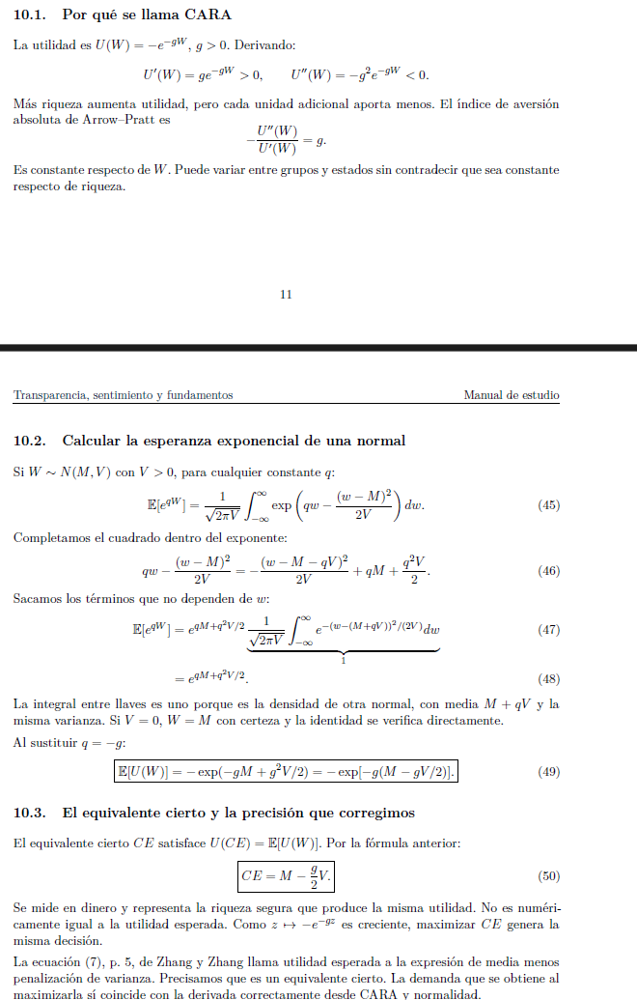
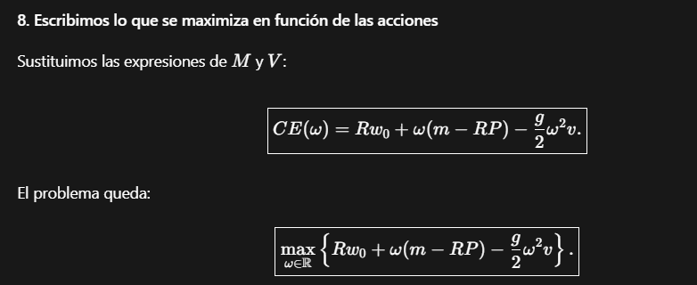

# Registro de IA: prompts y respuestas relevantes

## Prompt 1. La pregunta y la medida de respuesta del precio

**Estudiante:**

> Mi interés es entender cómo el optimismo y las expectativas mueven la bolsa. ¿Por qué nuestra pregunta ahora habla de transparencia? ¿Qué significa exactamente que el precio incorpore mejor los fundamentos?

**Codex :**

El modelo conserva inversionistas con sentimiento. Ese sentimiento afecta lo que esperan recibir, la incertidumbre que perciben y su disposición a asumir riesgo. Nuestra primera comparación pregunta qué cambia al divulgar información, manteniendo esos parámetros fijos.

El fundamento es θ, la noticia sobre el pago futuro. Medimos su incorporación mediante K=∂P̄/∂θ. Si una noticia aumenta el pago fundamental en S/1 y el precio esperado aumenta S/0.60, K es 0.60. Después compararemos K entre niveles de transparencia.

**Estudiante:**

> Entonces, si K pasa de 0.60 a 0.80, ¿puedo concluir que el precio de la acción aumentará?

**Codex:**

Puedes concluir que responde más a un mismo cambio de la noticia. Una noticia positiva de una unidad cambia el precio esperado en +0.80 en lugar de +0.60. Una noticia negativa de una unidad lo cambia en −0.80 en lugar de −0.60. El nivel del precio también contiene sesgos y compensación por riesgo. Por eso el resultado trata de sensibilidad y no implica una subida para cualquier noticia.

## Prompt 2. Por qué κ=μθ no deja información parcial

**Estudiante:**

> En la diapositiva aparece κ=μθ. Explícame qué significa cada símbolo y por qué dices que esa ecuación permite conocer toda la noticia aunque μ sea pequeño.

**Codex:**

θ es la noticia completa, κ el dato público y μ el parámetro conocido de transparencia. Si μ es positivo, basta dividir: θ=κ/μ.

Por ejemplo, si μ=0.5 y observo κ=4, descubro θ=8. Si μ fuera 0.1 y κ fuera 0.8, descubriría el mismo θ=8. Reducir el factor que multiplica la noticia no oculta su valor cuando se conoce el factor y se observa el producto exactamente.

**Estudiante:**

> ¿Qué ocurre si μ=0? ¿Y cuál es nuestra alternativa concreta?

**Codex:**

Con μ=0, el dato κ=0 no permite recuperar θ. Pero para cualquier μ positivo la información vuelve a ser completa bajo esa ecuación exacta.

Proponemos θ=κ+ξ. Todos observan κ y los particulares desconocen ξ. Conocer κ ya no permite despejar θ sin conocer también ξ. μ pasa a medir la fracción de varianza que se divulga, mediante Var(κ)=μs y Var(ξ)=(1−μ)s, donde s=Var(θ)>0. Los componentes son normales independientes, de media cero.

## Prompt 3. Varianza residual y recuperación del caso básico

**Estudiante:**

> No entiendo la diferencia entre la varianza publicada σ²ε+μ²s y nuestra varianza σ²ε+(1−μ)s. Usa números y dime qué representa σ²ε.

**Codex:**

σ²ε es la varianza de una sorpresa final que nadie conoce antes de recibir el pago. s es la varianza total de la noticia fundamental antes de observar sus componentes.

Supón σ²ε=4 y s=100. Para el particular racional:

| Transparencia | Fórmula publicada | Fórmula corregida |
|---|---:|---:|
| μ=0 | 4 | 104 |
| μ=0.5 | 29 | 54 |
| μ=1 | 104 | 4 |

En nuestra corrección, sin divulgación queda toda la incertidumbre de la noticia: 100, además de la sorpresa final: 4. Con divulgación completa desaparece la incertidumbre de θ y persiste la sorpresa final.

**Estudiante:**

> ¿El valor 54 significa que el agente espera recibir 54 soles? ¿Qué significa recuperar el modelo básico?

**Codex:**

54 es una varianza, expresada en soles al cuadrado. La media indica cuánto espera recibir; la varianza mide la dispersión alrededor de esa media. En ese ejemplo, una varianza de 54 corresponde a una desviación estándar de √54, aproximadamente S/7.35.

Recuperar el caso básico significa que μ=0 deja κ=0 y varianza residual s. El particular racional vuelve a esperar P₀ y a percibir varianza σ²ε+s. El particular sentimental vuelve a esperar P₀+δ₂ y a percibir σ²ε+s+τ²₂. No debería desaparecer la incertidumbre de una noticia que todavía no observa.

## Prompt 4. Las dos esperanzas condicionales

**Estudiante:**

> Tenemos E[θ|κ]=κ y E[κ|θ]=μθ. Me parecen contradictorias: ¿por qué una no es simplemente la inversa de la otra?

**Codex:**

Promedian cosas distintas.

E[θ|κ]=κ pregunta qué noticia completa espera un particular que observa κ. Como θ=κ+ξ y ξ es independiente y de media cero, su pronóstico es κ.

E[κ|θ]=μθ pregunta qué valores públicos son compatibles, en promedio, con una noticia completa θ. Bajo normalidad conjunta, Cov(κ,θ)=Var(κ)=μs y Var(θ)=s. El coeficiente de ese pronóstico es μs/s=μ.

Una esperanza condicional es un promedio y no una igualdad entre cada realización de las variables.

**Estudiante:**

> Dame un ejemplo que muestre esa diferencia y dime dónde necesitamos cada identidad.

**Codex:**

Con θ=10 y μ=0.5, el promedio condicional de κ es 5. Una realización puede ser κ=4 y ξ=6, y otra κ=7 y ξ=3. Ambas suman 10.

En la primera, el particular que sólo observa 4 pronostica θ=4, porque no conoce que ξ resultó ser 6. Esa expectativa puede diferir del valor finalmente realizado.

Usamos E[θ|κ]=κ para construir la media subjetiva del particular. Usamos E[κ|θ]=μθ al promediar precios compatibles con el mismo fundamento. Los estados de sentimiento son independientes de los componentes informativos y se mantienen fijos en esa comparación. El puente probabilístico todavía no está formalizado en nuestro Lean preliminar.

## Prompt 5. Medias, varianzas y los cuatro grupos

**Estudiante:**

> Quiero distinguir mᵢ de vᵢ. Si P₀=100, θ=10, κ=6, μ=0.4, s=100 y σ²ε=4, ¿qué saben una institución racional y un particular racional?

**Codex:**

La institución racional conoce θ=10. Espera m₁=100+10=110 y sólo conserva la sorpresa final: v₁=4.

El particular racional observa κ=6 y desconoce ξ. Espera m₃=100+6=106 y percibe v₃=4+(1−0.4)100=64.

mᵢ es el pago esperado por acción. vᵢ es su varianza subjetiva. El particular no sabe menos porque pronostique un pago menor en todos los casos: sabe menos porque le falta ξ. Si la parte oculta fuera negativa, su pronóstico podría superar el de la institución.

**Estudiante:**

> ¿Cómo quedan los grupos sentimentales si δ₁=δ₂=3 y τ²₁=τ²₂=9? ¿Eso cambia el pago real de la empresa?

**Codex:**

Sus creencias quedan así:

| Grupo | Media subjetiva | Varianza subjetiva |
|---|---:|---:|
| Institución racional | 110 | 4 |
| Institución sentimental | 113 | 13 |
| Particular racional | 106 | 64 |
| Particular sentimental | 109 | 73 |

δ añade un sesgo a la media y τ² añade incertidumbre subjetiva. El pago objetivo sigue siendo F=P₀+θ+ε. No sumamos δ o τ al pago real de la empresa.

La información distingue instituciones de particulares. Los parámetros sentimentales distinguen racionales de sentimentales dentro de cada tipo.

## Prompt 6. Por qué ρ, δ y τ² son objetos distintos

**Estudiante:**

> Estoy confundiendo ρ₂, δ₂ y τ²₂. Además, ¿por qué la aversión del particular sentimental se llama g₄ y usa ρ₂?

**Codex:**

El índice i=1,2,3,4 identifica grupos. El índice j=1,2 identifica el tipo de inversionista sentimental: institución o particular.

Por eso el grupo 2, institución sentimental, usa g₂=γ exp(−bρ₁), y el grupo 4, particular sentimental, usa g₄=γ exp(−bρ₂).

ρ₂ es el estado emocional observado. δ₂ es el sesgo esperado, que en la notación del paper llamamos ρ*₂. τ²₂ es la varianza subjetiva adicional, originalmente σ²ρ₂. Son parámetros distintos; no debes reemplazar automáticamente δ₂ por el valor de ρ₂.

**Estudiante:**

> Si γ=1, b=0.5 y ρ₂ pasa de cero a uno, ¿qué sucede con g₄ y con la posición?

**Codex:**

g₄ pasa de 1 a exp(−0.5), aproximadamente 0.6065. Con la misma media m₄, varianza v₄ y precio P, la magnitud de la demanda se multiplica por exp(0.5), aproximadamente 1.6487.

Si compraba, compra más. Si vendía corto, la posición negativa aumenta en magnitud. Si m₄=RP, la demanda sigue siendo cero. Esa comparación mantiene fijos los demás componentes de la decisión.

## Prompt 7. Equivalente cierto y derivación de la FOC

**Estudiante:**

> Explícame la función C₀,ᵢ+ωᵢ(mᵢ−RP)−gᵢvᵢωᵢ²/2. ¿Qué estoy maximizando? ¿Por qué usamos RP en lugar de P?

**Codex:**

Maximizas el equivalente cierto, una medida monetaria que representa la decisión de utilidad CARA cuando el pago se cree normal. ωᵢ es la cantidad de acciones, C₀,ᵢ riqueza independiente de esa elección, mᵢ el pago esperado, vᵢ su varianza y gᵢ la aversión al riesgo.

El coste P se compara en la fecha final: colocado a la tasa segura r_f, ese dinero habría sido RP, con R=1+r_f. Por eso mᵢ−RP es la ventaja monetaria esperada por acción frente a esa alternativa segura.

La ganancia crece linealmente con la posición y la penalización por riesgo crece con su cuadrado.

**Estudiante:**

> Deriva la FOC paso a paso. No entiendo por qué desaparece C₀,ᵢ ni por qué se cancela el 2.

**Codex:**

Derivamos respecto de ωᵢ, manteniendo mᵢ, vᵢ, gᵢ y P dados para el agente.

1. La derivada de C₀,ᵢ es cero porque no depende de ωᵢ.
2. La derivada de ωᵢ(mᵢ−RP) es mᵢ−RP.
3. La derivada de −gᵢvᵢωᵢ²/2 es −(gᵢvᵢ/2)·2ωᵢ=−gᵢvᵢωᵢ.

Al igualar a cero obtenemos mᵢ−RP−gᵢvᵢωᵢ=0. Despejando:

ω*ᵢ=(mᵢ−RP)/(gᵢvᵢ).

La segunda derivada es −gᵢvᵢ<0. Por eso la solución es un máximo único si gᵢ y vᵢ son positivos.

**Estudiante:**

> Usa mᵢ=110, P=100, R=1.02 y gᵢvᵢ=4. ¿Qué pasaría con menos riesgo o con una valoración pesimista?

**Codex:**

RP=102 y la ganancia esperada por acción es 8. La posición óptima es 8/4=2 acciones. Si gᵢvᵢ baja a 2, manteniendo esa ganancia, elige 4.

Si mᵢ fuera 98 con RP=102 y gᵢvᵢ=4, elegiría −1 acción, una venta corta. Si la penalización baja a 2, elegiría −2. Menos riesgo amplía la magnitud de la posición; su signo depende de la valoración.

## Prompt 8. Demanda agregada y precio de equilibrio

**Estudiante:**

> No veo cómo pasamos de cuatro demandas a P*=(Σhᵢmᵢ−1)/(RH). Explícame λᵢ, hᵢ y H y despeja el precio.

**Codex:**

λᵢ es la participación del grupo y las cuatro participaciones suman uno. Su contribución a la demanda agregada es λᵢω*ᵢ. Definimos hᵢ=λᵢ/(gᵢvᵢ) y H=Σhᵢ.

La oferta normalizada es uno. Al sustituir las demandas, el equilibrio exige:

Σλᵢω*ᵢ=Σhᵢ(mᵢ−RP)=1.

Distribuimos la suma:

Σhᵢmᵢ−RP·H=1.

Despejamos RP·H=Σhᵢmᵢ−1 y dividimos entre RH. El precio resultante hace que las decisiones individuales absorban toda la oferta.

**Estudiante:**

> Quiero un ejemplo de los cuatro grupos donde pueda verificar la igualdad de mercado, sin saltos.

**Codex:**

Tomemos λᵢ=1/4, gᵢ=1 y R=1. Para ilustrar la corrección, usemos P₀=100, θ=4, κ=2, μ=0.5, s=2, σ²ε=1, δ₁=δ₂=2 y τ²₁=τ²₂=0. Los estados ρ son cero y γ=1.

| Grupo | mᵢ | vᵢ | hᵢ=λᵢ/(gᵢvᵢ) |
|---|---:|---:|---:|
| 1 | 104 | 1 | 1/4 |
| 2 | 106 | 1 | 1/4 |
| 3 | 102 | 2 | 1/8 |
| 4 | 104 | 2 | 1/8 |

H=3/4 y Σhᵢmᵢ=78.25. Por tanto P*=(78.25−1)/(3/4)=103.

Las posiciones son 1, 3, −0.5 y 0.5 acciones. Su promedio ponderado es (1+3−0.5+0.5)/4=1. La demanda absorbe exactamente la oferta.

Este ejemplo usa varianzas sentimentales adicionales cero, permitidas por τ²ⱼ≥0. Es distinto del contraejemplo de las fórmulas publicadas, que usa todas las varianzas primitivas iguales a uno.

## Prompt 9. Cuándo el peso de un grupo sube o baja el precio

**Estudiante:**

> Yo pensaba que si un grupo se vuelve más importante, siempre sube el precio. En el ejemplo anterior, ¿qué sucede si pesa más el particular racional?

**Codex:**

Ese particular espera 102, mientras RP*=103. Su valoración es menor que el coste al final. A precio dado desea vender corto, por lo que aumentar su peso puede reducir el precio.

Manteniendo las medias y otros pesos dados, la derivada es:

∂P*/∂hᵢ=(mᵢ−RP*)/(RH).

En el grupo 3, el numerador es −1 y RH=3/4, así que la derivada es −4/3. Para el grupo 2, el numerador es 106−103=3 y la derivada es 4: aumentar su peso tiene el signo contrario.

**Estudiante:**

> ¿Puedo usar esa derivada para concluir el efecto completo de aumentar μ?

**Codex:**

No basta. La derivada anterior cambia sólo un peso y mantiene las valoraciones dadas. Aumentar μ cambia la incertidumbre de ambos particulares y, en la comparación de precios esperados, también la respuesta de sus medias a θ. Debemos incorporar esos cambios conjuntamente mediante K(μ). Es una comparación distinta.

## Prompt 10. De dónde sale K y por qué crece

**Estudiante:**

> Explícame el numerador a+μB y el denominador R(a+B). También quiero saber si podemos tratar B como constante.

**Codex:**

a=h₁+h₂ suma el peso institucional y B=h₃+h₄ el particular. Las instituciones usan toda θ y su media responde con coeficiente uno. Los particulares usan κ, cuyo promedio condicionado a θ es μθ. Por eso la respuesta ponderada es a+μB.

Dividir entre a+B normaliza por los pesos de todos los grupos y dividir entre R descuenta el pago. Así:

K(μ)=(a+μB(μ))/(R[a+B(μ)]).

B no es constante. Al aumentar μ, disminuye el riesgo informativo de los particulares y cambia su peso, aunque mantengamos fijos los parámetros sentimentales.

**Estudiante:**

> Entonces no basta con decir que μ está en el numerador. ¿Cómo muestra la derivada que el efecto total es positivo?

**Codex:**

Definimos n₃=λ₃/γ, n₄=λ₄/g₄, d₃=σ²ε+(1−μ)s y d₄=σ²ε+τ²₂+(1−μ)s. Entonces B=n₃/d₃+n₄/d₄.

Al derivar el cociente, con a y R fijos, aparece:

K'=[B²+a(B−(1−μ)B')]/[R(a+B)²].

Como B'=s(n₃/d₃²+n₄/d₄²), se obtiene:

B−(1−μ)B'=n₃σ²ε/d₃²+n₄(σ²ε+τ²₂)/d₄².

Todos esos términos son positivos bajo nuestros supuestos. Eso explica el signo de la derivada e incluye el cambio de B.

La prueba preliminar de Lean demuestra la comparación K(x)<K(y) mediante identidades algebraicas y diferencias finitas. No debemos describirla como una formalización de todos los pasos de cálculo diferencial y probabilidades de esta respuesta.

## Prompt 11. La ampliación con sentimiento que cambia al divulgar

**Estudiante:**

> ¿Dónde está la ampliación adicional? Quiero plantear algo concreto: que la información pública pueda generar miedo. ¿Qué ecuación tendríamos que cambiar?

**Codex:**

Como escenario adicional, podemos proponer estados sentimentales que dependan de μ: ρ₁(μ) y ρ₂(μ). Entonces g₂(μ)=γ exp(−bρ₁(μ)) y g₄(μ)=γ exp(−bρ₂(μ)).

Si una divulgación reduce ρ₂, aumenta g₄. El particular sentimental acepta menos riesgo, lo que puede compensar parte del aumento de su peso provocado por una menor incertidumbre informativa.

La ecuación de demanda mantiene su forma, pero cambian sus coeficientes. a y B ahora pueden depender de μ. Por eso la prueba que mantiene fijos esos estados no resuelve automáticamente este escenario.

**Estudiante:**

> ¿Puedes escribir una condición preliminar para conservar K'>0, sin afirmar que ya está demostrada en nuestro Lean?

**Codex:**

En una primera versión de esa ampliación, supongamos a(μ) y B(μ) positivos y diferenciables, R fijo, estados que dependen de μ pero no de θ, y que se mantiene la identidad del precio esperado. Entonces la forma de K sigue siendo:

K=(a+μB)/(R(a+B)).

Al derivar permitiendo que ambos pesos cambien:

K'={B(a+B)−(1−μ)[aB'−Ba']}/[R(a+B)²].

Una condición candidata para K'>0 es:

B(a+B)>(1−μ)[aB'−Ba'].

El término aB'−Ba' recoge cómo cambia el peso particular respecto del institucional. Debemos derivar a' y B' a partir de las funciones sentimentales propuestas y comprobar esta condición. Esta es una derivación exploratoria para discutir la ampliación: no es una proposición ya incorporada o formalizada en la entrega.

**Estudiante:**

> ¿Y si ρ también depende de la noticia θ, en lugar de depender sólo de μ?

**Codex:**

Cambiaría también la derivada respecto de θ. Al reaccionar el sentimiento a la noticia, podrían variar las aversiones, los pesos y los sesgos de las medias. La respuesta total del precio añadiría esos efectos.

Además, condicionar en estados sentimentales fijos y estudiar estados endógenos que cambian con θ son comparaciones distintas. Habría que definir nuevamente la métrica y las creencias condicionales. Para mantener una primera ampliación manejable, conviene estudiar primero estados que cambian con μ y explicitar su independencia de los componentes informativos.

## Prompt 12. Posiciones sin ventas cortas

**Estudiante:**

> Como otra posibilidad, ¿qué pasa si un inversionista no puede vender corto? ¿La FOC que tenemos seguiría siendo suficiente?

**Codex:**

Sería un escenario adicional con restricción ωᵢ≥0. La solución del problema cuadrático pasa a ser:

ω*ᵢ=max{0,(mᵢ−RP)/(gᵢvᵢ)}.

Si el pago esperado supera RP, la solución es interior y usa nuestra FOC. Si el pago esperado queda por debajo, el agente elige cero y no la posición negativa que permite el modelo principal. En ese punto se necesitan condiciones de esquina o KKT.

El equilibrio exigiría Σλᵢ max{0,(mᵢ−RP)/(gᵢvᵢ)}=1. El conjunto de grupos que compra puede cambiar con el precio, así que la fórmula lineal actual de equilibrio no sirve globalmente.

**Estudiante:**

> ¿Lo incluyo ya como parte de nuestra contribución principal?

**Codex:**

La primera entrega se concentra en la corrección informativa y el escenario de sentimiento variable. Las restricciones de ventas cortas pueden discutirse como otra opción de extensión. Antes de atribuirle novedad hay que revisar qué restricciones y variantes considera el artículo y la literatura pertinente.

Este escenario no está cubierto por los certificados actuales ni debe presentarse como resultado obtenido.

## Prompt 13. Información que puede inferirse del precio

**Estudiante:**

> Si los particulares observan el precio P*, ¿no podrían descubrir lo que saben las instituciones? ¿Cómo afecta eso a nuestra propuesta?

**Codex:**

Es una limitación que debemos hacer explícita. Nuestro modelo mantiene la restricción de no extraer información adicional del precio.

Con parámetros y sesgos conocidos, las medias de los cuatro grupos permiten escribir:

RP*H=HP₀+aθ+Bκ+h₂δ₁+h₄δ₂−1.

Como a>0, un particular que conoce P*, κ y los demás términos podría despejar:

θ=[RP*H−HP₀−Bκ−h₂δ₁−h₄δ₂+1]/a.

Así, el precio podría revelar la noticia completa bajo esas condiciones. Si permitimos esa inferencia, debemos actualizar las creencias y volver a resolver el equilibrio, porque también cambian las varianzas y los pesos h.

**Estudiante:**

> ¿Qué escenario podríamos estudiar para que el precio no revele exactamente θ?

**Codex:**

Una opción exploratoria sería oferta aleatoria S=1+u, con un componente u que los agentes no observan directamente. La igualdad de mercado usaría S y el precio sería P*=(Σhᵢmᵢ−S)/(RH).

Entonces un movimiento del precio podría reflejar noticia o variación de oferta, y ya no bastaría el despeje anterior si u es desconocido. Habría que especificar qué observa cada grupo y resolver sus creencias condicionales y el equilibrio conjuntamente.

Esa opción todavía no está desarrollada en el proyecto. Sirve para delimitar la restricción actual y no para afirmar que ya resolvimos un equilibrio completo de expectativas racionales.

## Prompt 14. Qué respalda Lean y qué entregaré

**Estudiante:**

> Si el profesor pregunta qué hemos comprobado de verdad, ¿cómo distingo el contraejemplo, nuestra corrección y las ampliaciones?

**Codex:**

Puedes separar tres estados:

1. **Contraejemplo de las fórmulas impresas:** comprobado algebraicamente. Con los parámetros documentados, K₀=9/14 y Kᴵ(0.1)=66943/121303<K₀.
2. **Corrección informativa:** la función racional K tiene una prueba preliminar de aumento estricto para cuatro grupos y un resultado de información completa K(1)=1/R. El puente entre las esperanzas gaussianas y esa función sigue sin formalización probabilística en Lean.
3. **Ampliaciones:** estados sentimentales que cambian, restricciones de ventas cortas e inferencia desde precios son escenarios por desarrollar. Las hipótesis de la prueba actual no cubren automáticamente esos escenarios.

**Estudiante:**

> ¿Qué hipótesis concretas aparecen en la declaración de cuatro grupos? ¿No estamos asumiendo desde el principio que K aumenta?

**Codex:**

La declaración four_group_information_increases usa a,n₃,n₄,e₃,e₄,R positivos, t≥0 y x<y≤1. Identificamos e₃=σ²ε, e₄=σ²ε+τ²₂ y t=s. La propuesta económica añade 0≤x y usa s>0.

No contiene K(x)<K(y) entre sus hipótesis. Esa desigualdad es la conclusión que prueba. Las instituciones se agregan en a=h₁+h₂ y los dos grupos particulares conservan pesos y riesgos distintos.

**Estudiante:**

> Para la primera entrega, ¿cuál es la pregunta, la FOC y el resultado que debería destacar sin convertir mi exposición en un resumen del paper?

**Codex:**

La pregunta es cuándo una mayor transparencia fortalece la respuesta esperada del precio a los fundamentos en presencia de sentimiento.

La FOC esperada conserva la forma mᵢ−RP−gᵢvᵢωᵢ=0. Nuestra corrección cambia, para el particular racional, el coeficiente de riesgo a γ[σ²ε+(1−μ)s], y modifica también la media y varianza de ambos particulares.

El resultado objetivo es K(y)>K(x) para 0≤x<y≤1 bajo condiciones explícitas, con K(1)=1/R. El aporte consiste en corregir la información parcial, recuperar el caso sin divulgación y volver a derivar ese resultado. Las ampliaciones sirven para estudiar cuáles de esas condiciones son esenciales.

Nota de procedencia: los diálogos de estudio de este archivo son ejemplos simulados, no transcripciones reales. Las incorporaciones siguientes conservan esa identificación.

## Prompt 15. Derivar las proporciones desde una señal

**Estudiante:**

> No quiero asumir directamente Var(κ)=μs. Supón que el público observa y=θ+η, con varianzas s y t. ¿Cómo llegas al peso μ y a esa varianza?

**Codex:**

Bayes combina las densidades normal previa y del ruido. Completar el cuadrado da θ|y normal con media s·y/(s+t) y varianza st/(s+t). Defino μ=s/(s+t) y κ=μy. La independencia implica Var(y)=s+t. Entonces Var(κ)=μ²(s+t)=s²/(s+t)=μs. La proporción se deriva del pronóstico posterior; no significa que κ sea una fracción exacta del θ realizado.

## Prompt 16. Residuo y covarianza

**Estudiante:**

> Si ξ=θ−κ, muéstrame la varianza sin saltarte términos. ¿Por qué afirmas que κ y ξ son independientes?

**Codex:**

ξ=(1−μ)θ−μη. Su varianza es (1−μ)²s+μ²t−2μ(1−μ)Cov(θ,η). La independencia original anula la covarianza. Sustituir μ=s/(s+t) entrega st/(s+t)=(1−μ)s. Después calculo Cov(κ,ξ)=μ(1−μ)s−μ²t=0. Como son conjuntamente gaussianos, esa covarianza cero implica independencia. Sin normalidad conjunta no basta ese cálculo para concluir independencia.

## Prompt 17. CARA, riqueza y CPO

**Estudiante:**

> ¿Por qué aparece ω² en la varianza de riqueza y cómo pasas de utilidad exponencial a la CPO? ¿CARA determina la varianza del pago?

**Codex :**

La cartera produce W=C₀+ω(F−RP). Durante la elección, las constantes no generan varianza y Var(ωF)=ω²Var(F)=ω²v. CARA utiliza esa varianza, que proviene de la información y las creencias. Si W es normal con media M y varianza V, integrar la utilidad da E[U]=−exp(−gM+g²V/2). La transformación creciente permite maximizar CE=M−gV/2. Sustituyendo M y V resulta CE=C₀+ω(m−RP)−gvω²/2. Derivar entrega m−RP−gvω=0; dividir por gv>0 da la demanda. La segunda derivada −gv<0 y completar el cuadrado prueban el máximo único.

## Prompt 18. Emisor y ventaja informativa

**Estudiante:**

> ¿La información privada significa que la empresa oculta un dato y lo transmite a ciertos agentes? ¿El modelo demuestra que esos agentes ganan más?

**Codex :**

El modelo especifica conjuntos informativos de inversionistas. No incluye una empresa que elige a quién transmitir un dato. La aplicación se delimita a una acción con información desigual entre instituciones y particulares; observar θ exactamente es una idealización. Un dato que solo conoce el emisor no pertenece a la θ conocida por instituciones. Para modelar una filtración se necesitan un canal y sus incentivos. La ventaja informativa puede modificar posiciones, pero no demuestra una rentabilidad extraordinaria: hacen falta precio, riesgo, costos, horizonte y referencia de comparación. El resultado obtenido corresponde a sensibilidad esperada del precio.

---

Los apartados 19–24 corresponden a intercambios reales de estudio del 3 de noviembre de 2026. Se conservan las preguntas y respuestas de la conversación; únicamente se adaptan los delimitadores matemáticos para su lectura en Markdown. Las capturas adjuntas se conservan junto al registro. La nota de procedencia anterior corresponde a los apartados 1–18.

## Prompt 19. Utilidad CARA, restricciones y qué se maximiza

**Estudiante:**

> A qué te refieres con Utilidad CARA y las CPO, cuál es la función de utilidad, cuales son las restricciones y qué se maximiza?

**Codex:**

**Cada inversionista elige cuántas acciones comprar o vender para maximizar la utilidad esperada de su riqueza futura.** Para decidir, compara la ganancia que espera obtener con el riesgo que debe asumir.

La función CARA describe cómo valora esa riqueza; la **CPO —condición de primer orden—** permite encontrar la cantidad óptima de acciones. Vamos paso a paso.

**1. ¿Qué puede elegir el inversionista?**

Llamamos $\omega$ al número de acciones que decide mantener:

- $\omega>0$: compra acciones.
- $\omega=0$: no mantiene acciones.
- $\omega<0$: toma una posición corta, es decir, apuesta a una caída mediante una venta en corto.

El precio actual $P$ es un dato para cada inversionista: individualmente, supone que su decisión no lo modifica. Después, el modelo determina el precio que hace compatibles las decisiones de todos.

**2. ¿Cuál es la restricción presupuestaria?**

El inversionista tiene una riqueza inicial $w_0$, que distribuye entre acciones y un activo seguro:

$$
\boxed{w_0=\omega P+c.}
$$

Aquí:

| Variable | Significado |
|---|---|
| $w_0$ | Dinero disponible inicialmente. |
| $P$ | Precio actual de una acción. |
| $\omega P$ | Dinero destinado a acciones. |
| $c$ | Dinero colocado en el activo seguro. |

Por tanto:

$$
c=w_0-\omega P.
$$

En la versión que trabajamos, **no imponemos límites a las ventas en corto ni al endeudamiento**: $\omega$ puede ser cualquier número real y $c$ puede ser negativo. Si $c<0$, el inversionista pide prestado para financiar su posición.

Esta es una simplificación importante. Con restricciones como $\omega\geq0$ o $c\geq0$, la solución podría quedar en un límite y habría que incorporar esas condiciones.

**3. ¿Cómo queda su riqueza futura?**

Una acción entrega un pago futuro incierto $F$. El activo seguro multiplica el dinero invertido por $R$, donde, por ejemplo, $R=1{,}05$ representa un rendimiento del $5\%$.

La riqueza final es:

$$
W=\omega F+Rc.
$$

Sustituyendo la restricción presupuestaria:

$$
W=\omega F+R(w_0-\omega P).
$$

Reordenando:

$$
\boxed{W=Rw_0+\omega(F-RP).}
$$

La interpretación es:

> Si destinara toda su riqueza al activo seguro, terminaría con $Rw_0$. Cada acción que incorpora cambia esa riqueza en $F-RP$.

¿Por qué aparece $RP$? Porque comprar una acción cuesta $P$ hoy, y ese mismo dinero habría producido $RP$ si se hubiera colocado en el activo seguro. Es el **costo de oportunidad**.

**4. ¿Cuál es la función de utilidad CARA?**

Usamos:

$$
\boxed{u(W)=-e^{-gW},\qquad g>0.}
$$

El parámetro $g$ mide la aversión al riesgo. Un $g$ mayor representa una mayor penalización del riesgo.

Esta función cumple:

$$
u'(W)=ge^{-gW}>0,
$$

por lo que **más riqueza aumenta la utilidad**, y

$$
u''(W)=-g^2e^{-gW}<0,
$$

por lo que el inversionista es adverso al riesgo.

Aunque la utilidad sea negativa, funciona perfectamente: por ejemplo, $-0{,}1$ es mayor y preferible a $-0{,}5$.

CARA significa *aversión absoluta al riesgo constante*, porque:

$$
-\frac{u''(W)}{u'(W)}=g.
$$

**5. ¿Qué se maximiza exactamente?**

Como el pago $F$ es incierto, el inversionista maximiza la **utilidad esperada**, usando la información que tiene:

$$
\boxed{\max_{\omega\in\mathbb R}
\mathbb E\!\left[-e^{-gW}\mid\mathcal I\right].}
$$

$\mathcal I$ representa su información. Para un particular racional, contiene el reporte público $y$, con el que calcula $\kappa$; para una institución racional, nuestro modelo supone que incluye $\theta$.

Definimos:

$$
m=\mathbb E[F\mid\mathcal I],
\qquad
v=\operatorname{Var}(F\mid\mathcal I).
$$

Es decir:

- $m$: cuánto cree que pagará, en promedio, una acción.
- $v$: cuánta incertidumbre considera que tiene ese pago.

Entonces:

$$
\mathbb E[W\mid\mathcal I]=Rw_0+\omega(m-RP),
$$

$$
\operatorname{Var}(W\mid\mathcal I)=\omega^2v.
$$

La segunda ecuación indica que **una posición más grande amplifica el riesgo de la riqueza final**. Duplicar la posición multiplica su varianza por cuatro.

**6. ¿Cómo aparecen la CPO y la demanda óptima?**

Con utilidad CARA y un pago normalmente distribuido, la utilidad esperada se puede escribir como:

$$
\mathbb E[u(W)\mid\mathcal I]
=
-\exp\!\left[
-g\left(
Rw_0+\omega(m-RP)-\frac g2\omega^2v
\right)
\right].
$$

Como $-e^{-gz}$ aumenta cuando aumenta $z$, maximizar esa expresión equivale a maximizar:

$$
\boxed{
CE(\omega)=Rw_0+\omega(m-RP)-\frac g2\omega^2v.
}
$$

Esto se llama **equivalente cierto**: riqueza esperada menos una penalización por el riesgo. No es la utilidad esperada misma; es una expresión que permite encontrar la misma decisión óptima.

Derivamos respecto de lo que el inversionista elige, $\omega$:

$$
\frac{dCE}{d\omega}=m-RP-g\omega v.
$$

La CPO iguala esa derivada a cero:

$$
\boxed{m-RP-g\omega v=0.}
$$

Despejando:

$$
\boxed{\omega^*=\frac{m-RP}{gv}.}
$$

Además:

$$
\frac{d^2CE}{d\omega^2}=-gv<0,
$$

si $g>0$ y $v>0$. Por eso encontramos un **máximo único**.

La fórmula dice que el inversionista mantiene una posición mayor cuando espera una ganancia mayor frente al activo seguro, y una posición menor cuando percibe más riesgo o tiene más aversión al riesgo.

Por ejemplo, para el **particular racional** de nuestro modelo:

$$
m=P_0+\kappa,
\qquad
v=\sigma_\varepsilon^2+(1-\mu)s.
$$

Su demanda óptima es:

$$
\boxed{
\omega_3^*
=
\frac{P_0+\kappa-RP}
{g_3\left[\sigma_\varepsilon^2+(1-\mu)s\right]}.
}
$$

Aquí se conectan tus derivaciones manuscritas con la decisión económica: **$\kappa$ entra en el pago que espera recibir; la varianza restante entra en el riesgo que debe asumir al comprar.**

## Prompt 20. Financiamiento, preferencias y esperanza de la riqueza

**Estudiante:**

> Primera pregunta, si c<0 dónde se incluye el costo de financiamiento? La función de utilidad CARA indica que siempre el inversionista es adverso al riesgo? y que pasa si es amante del riesgo? Por qué usas m enves de F en la esperanza de W? Por qué consideras que la varianza de RP es cero?

**Codex:**

Tus cuatro preguntas ayudan a identificar los supuestos del modelo y sus límites.

**1. Si $c<0$, ¿dónde está el costo del financiamiento?**

Está incluido en el término $Rc$ de la riqueza final:

$$
W=\omega F+Rc.
$$

Si $c<0$, ese término representa la deuda que debe devolver, incluidos los intereses.

Por ejemplo:

- Riqueza inicial: $w_0=100$.
- Compra de acciones: $\omega P=150$.
- Entonces $c=100-150=-50$: pide prestados $50$.
- Si $R=1{,}10$, al final devuelve $55$:

$$
Rc=1{,}10(-50)=-55.
$$

Su riqueza final será el pago de sus acciones menos esos $55$.

**El supuesto simplificador es que puede pedir prestado a la misma tasa a la que puede ahorrar.** Si quisiéramos diferenciar ambas tasas:

$$
W=
\begin{cases}
\omega F+R_s c,&c\geq0,\\
\omega F+R_b c,&c<0,
\end{cases}
\qquad R_b>R_s.
$$

Aquí $R_b$ es el factor de devolución del préstamo. Esto modificaría la demanda óptima: el costo de oportunidad dependería de si está ahorrando o endeudándose.

**2. ¿La utilidad CARA supone siempre aversión al riesgo? ¿Y si le gusta el riesgo?**

**La función que usamos, con $g>0$, sí supone aversión al riesgo:**

$$
u(W)=-e^{-gW},
\qquad
u''(W)=-g^2e^{-gW}<0.
$$

La concavidad significa que, entre recibir una cantidad segura y participar en una apuesta con esa misma riqueza esperada, prefiere la cantidad segura.

Un inversionista neutral al riesgo podría tener:

$$
u(W)=W.
$$

Uno amante del riesgo tendría una función creciente y convexa, por ejemplo:

$$
u(W)=e^{gW},\qquad g>0.
$$

Pero esto cambia profundamente el problema. Con posiciones ilimitadas, el amante del riesgo puede querer asumir posiciones cada vez mayores y **puede no existir una cantidad óptima finita**. Harían falta restricciones u otra estructura.

No basta con poner $g<0$ en nuestra función original: eso también haría que la utilidad disminuyera con la riqueza.

**3. ¿Por qué aparece $m$ en la esperanza de $W$, en lugar de $F$?**

Porque $F$ es el pago futuro incierto, mientras que $m$ es **su valor esperado según la información del inversionista**:

$$
m=\mathbb E[F\mid\mathcal I].
$$

Partimos de:

$$
W=Rw_0+\omega(F-RP).
$$

Tomamos esperanza, manteniendo fija la información disponible y la posición elegida:

$$
\begin{aligned}
\mathbb E[W\mid\mathcal I]
&=Rw_0+\omega\left(\mathbb E[F\mid\mathcal I]-RP\right)\\
&=\boxed{Rw_0+\omega(m-RP).}
\end{aligned}
$$

**No reemplazamos el pago real por su promedio dentro de la riqueza real.** La riqueza realizada depende de $F$; la riqueza esperada depende de $m$.

Por ejemplo, el inversionista puede esperar que la acción pague $110$, aunque finalmente pague $90$ o $130$.

**4. ¿Por qué la varianza de $RP$ es cero?**

Porque estamos calculando la incertidumbre **en el momento de decidir**, cuando el inversionista ya observa el precio actual $P$, y suponemos que $R$ es conocido y seguro.

Por tanto:

$$
\operatorname{Var}(RP\mid\mathcal I)=0.
$$

Una cantidad conocida puede ser alta o baja, pero no tiene incertidumbre para esa decisión.

Así:

$$
\begin{aligned}
\operatorname{Var}(W\mid\mathcal I)
&=\operatorname{Var}\!\left(Rw_0+\omega(F-RP)\mid\mathcal I\right)\\
&=\omega^2\operatorname{Var}(F\mid\mathcal I)\\
&=\boxed{\omega^2v}.
\end{aligned}
$$

**Esto no significa que el precio nunca cambie o que sea siempre predecible.** Antes de observar el reporte y el equilibrio, el precio puede ser aleatorio. Aquí estamos en una etapa posterior: el inversionista observa el precio al que puede operar y decide su posición; lo incierto es cuánto pagará el activo al final.

Si incorporáramos una venta futura a un precio todavía desconocido, ese precio futuro también tendría que entrar en el riesgo de la inversión.

## Prompt 21. Qué tipos de preferencias incluye el modelo

**Estudiante:**

> entonces en este estudio solo se asumen individuos adversos al reisgo? y no neutrales ni amantes?

**Codex:**

Sí. **En la versión del modelo que estamos trabajando, todos los inversionistas son adversos al riesgo**: utilizan utilidad CARA con un coeficiente $g_i>0$.

Lo que cambia entre grupos es:

- **La información disponible:** algunos observan $\theta$; otros forman el pronóstico $\kappa$.
- **Sus creencias:** pueden ser racionales o estar influidas por el sentimiento.
- **El grado de aversión al riesgo:** unos pueden tolerar más riesgo que otros, pero todos mantienen $g_i>0$.

**Un inversionista optimista o influido por el sentimiento no necesariamente es amante del riesgo.** Puede comprar más porque cree que el activo pagará más, porque percibe menos incertidumbre o porque disminuye su aversión al riesgo.

No incluimos agentes neutrales ni amantes del riesgo. Incorporarlos exigiría revisar el equilibrio: con endeudamiento y posiciones ilimitadas, podrían querer asumir posiciones sin límite y dejaría de existir la demanda óptima finita que usamos.

Para tu exposición puedes decir:

> «El modelo supone inversionistas adversos al riesgo. Estudia cómo la información y el sentimiento modifican sus decisiones dentro de ese supuesto; no compara individuos adversos, neutrales y amantes del riesgo».

## Prompt 22. Derivación paso a paso de CARA y las CPO

**Estudiante:**

> me puedes explicar por qué haces todo esto? y dame la derivación paso a paso de la CARA y las CPO

**Codex:**

**Hacemos esta derivación para pasar de “el inversionista tiene información y teme al riesgo” a una decisión concreta: cuántas acciones compra o vende.** Esa demanda individual es la que después usamos para determinar el precio de equilibrio.

La secuencia es:

$$
\text{Riqueza futura}
\;\longrightarrow\;
\text{utilidad esperada}
\;\longrightarrow\;
\text{problema de maximización}
\;\longrightarrow\;
\text{cantidad óptima de acciones}.
$$

Voy a separar las derivadas **respecto de la riqueza $W$**, que describen las preferencias, de las derivadas **respecto de las acciones $\omega$**, que permiten encontrar la decisión óptima.

**1. Primero: ¿qué suponemos y qué queremos encontrar?**

El inversionista decide una cantidad de acciones $\omega$. Su presupuesto es:

$$
w_0=\omega P+c,
$$

y su riqueza al final es:

$$
W=\omega F+Rc.
$$

Sustituyendo $c=w_0-\omega P$:

$$
\boxed{W=Rw_0+\omega(F-RP).}
$$

Las variables son:

| Símbolo | Significado |
|---|---|
| $w_0$ | Riqueza inicial. |
| $\omega$ | Cantidad de acciones elegida. |
| $P$ | Precio actual por acción, observado al decidir. |
| $F$ | Pago futuro incierto por acción. |
| $R$ | Factor de rendimiento seguro, conocido. |
| $W$ | Riqueza final, que depende del pago incierto $F$. |

Permitimos $\omega\in\mathbb R$: no imponemos límites al endeudamiento ni a las posiciones cortas.

**El objetivo es encontrar $\omega^*$, no elegir directamente cuánto valdrá $W$**: el inversionista controla su posición, pero no controla el pago futuro.

**2. Elegimos una función para representar sus preferencias**

Suponemos:

$$
\boxed{U(W)=-e^{-gW},\qquad g>0.}
$$

Esta función **es un supuesto del modelo**. No se obtiene de Bayes. Bayes sirve para formar las creencias sobre el pago; la utilidad describe cómo se valoran la riqueza y el riesgo.

Veamos sus propiedades derivando respecto de $W$.

Por la regla de la cadena:

$$
\frac{d}{dW}e^{-gW}=e^{-gW}(-g).
$$

Como delante hay un signo negativo:

$$
U'(W)=-e^{-gW}(-g)
=\boxed{ge^{-gW}>0}.
$$

Esto indica que **más riqueza aumenta la utilidad**.

Derivando una segunda vez:

$$
U''(W)=g\,e^{-gW}(-g)
=\boxed{-g^2e^{-gW}<0}.
$$

Esto indica que **la utilidad es cóncava**: una unidad adicional de riqueza aporta menos utilidad cuanto más rico es el inversionista. Esa concavidad representa aversión al riesgo.

**3. ¿Por qué se llama CARA?**

El índice de aversión absoluta al riesgo de Arrow–Pratt es:

$$
A(W)=-\frac{U''(W)}{U'(W)}.
$$

Sustituimos nuestras derivadas:

$$
A(W)
=
-\frac{-g^2e^{-gW}}{ge^{-gW}}.
$$

Cancelamos el factor exponencial y simplificamos:

$$
\boxed{A(W)=g.}
$$

El índice no depende de $W$. Por eso se llama **aversión absoluta al riesgo constante**, o CARA.

No significa que todos tengan el mismo $g$. Cada grupo puede tener uno diferente. Significa que, para un inversionista y unas condiciones dadas, ese coeficiente no cambia con su riqueza.

**4. Calculamos la media y la varianza de la riqueza**

Según la información y las creencias del inversionista, suponemos:

$$
F\mid\mathcal I\sim N(m,v),
$$

donde:

$$
m=\mathbb E[F\mid\mathcal I],
\qquad
v=\operatorname{Var}(F\mid\mathcal I)>0.
$$

Como $W$ es una transformación lineal de $F$, también tiene distribución normal para una posición distinta de cero.

Su media es:

$$
\begin{aligned}
M
&=\mathbb E[W\mid\mathcal I]\\
&=\mathbb E[Rw_0+\omega(F-RP)\mid\mathcal I]\\
&=\boxed{Rw_0+\omega(m-RP)}.
\end{aligned}
$$

Su varianza es:

$$
\begin{aligned}
V
&=\operatorname{Var}(W\mid\mathcal I)\\
&=\operatorname{Var}(\omega F\mid\mathcal I)\\
&=\boxed{\omega^2v}.
\end{aligned}
$$

Los demás términos son conocidos cuando decide, por lo que no agregan varianza.

Para evitar confusiones:

| | Pago de una acción $F$ | Riqueza total $W$ |
|---|---|---|
| Media | $m$ | $M=Rw_0+\omega(m-RP)$ |
| Varianza | $v$ | $V=\omega^2v$ |

**5. ¿Por qué aparece esa integral en el manual?**

El inversionista maximiza:

$$
\mathbb E[U(W)\mid\mathcal I]
=
-\mathbb E[e^{-gW}\mid\mathcal I].
$$

No podemos sustituir simplemente la riqueza por su promedio, porque, en general:

$$
\mathbb E[U(W)]\neq U(\mathbb E[W]).
$$

Si lo hiciéramos, perderíamos el efecto del riesgo.

Por eso necesitamos calcular la esperanza de la función exponencial. Para simplificar la notación, omitimos temporalmente el condicionamiento y usamos una constante auxiliar $q$. Después pondremos $q=-g$.

Si $W\sim N(M,V)$, con $V>0$, su densidad es:

$$
f_W(w)=
\frac{1}{\sqrt{2\pi V}}
\exp\left[-\frac{(w-M)^2}{2V}\right].
$$

La definición de esperanza nos dice que debemos multiplicar cada valor de $e^{qw}$ por su densidad e integrar:

$$
\begin{aligned}
\mathbb E[e^{qW}]
&=\int_{-\infty}^{\infty}e^{qw}f_W(w)\,dw\\
&=\frac{1}{\sqrt{2\pi V}}
\int_{-\infty}^{\infty}
\exp\left[
qw-\frac{(w-M)^2}{2V}
\right]dw.
\end{aligned}
$$

Aquí $w$ es una variable de integración: recorre los posibles valores de la riqueza final.

**6. Completamos el cuadrado para resolver la integral**

El objetivo es transformar el exponente para reconocer otra densidad normal.

Partimos de:

$$
qw-\frac{(w-M)^2}{2V}.
$$

Como $w=M+(w-M)$:

$$
=qM+q(w-M)-\frac{(w-M)^2}{2V}.
$$

Llevamos los dos últimos términos al mismo denominador:

$$
=qM-\frac{(w-M)^2-2qV(w-M)}{2V}.
$$

Usamos la identidad:

$$
a^2-2ab=(a-b)^2-b^2,
$$

con $a=w-M$ y $b=qV$. Entonces:

$$
=qM-\frac{(w-M-qV)^2-q^2V^2}{2V}.
$$

Separando:

$$
\boxed{
qw-\frac{(w-M)^2}{2V}
=
-\frac{(w-M-qV)^2}{2V}
+qM+\frac{q^2V}{2}.
}
$$

Los dos últimos términos no dependen de $w$, así que salen de la integral:

$$
\mathbb E[e^{qW}]
=
e^{qM+q^2V/2}
\underbrace{
\frac{1}{\sqrt{2\pi V}}
\int_{-\infty}^{\infty}
e^{-\frac{[w-(M+qV)]^2}{2V}}dw
}_{=1}.
$$

La integral vale uno porque es la integral de una densidad normal completa, con media $M+qV$ y varianza $V$.

Por tanto:

$$
\boxed{\mathbb E[e^{qW}]=e^{qM+q^2V/2}.}
$$

Si $V=0$, la riqueza es segura, $W=M$, y la misma fórmula se verifica directamente.

**7. Ahora aplicamos el resultado a la utilidad CARA**

Sustituimos $q=-g$:

$$
\mathbb E[e^{-gW}]
=
e^{-gM+g^2V/2}.
$$

Recuperando el signo negativo de la utilidad:

$$
\boxed{
\mathbb E[U(W)]
=
-e^{-gM+g^2V/2}.
}
$$

Factorizamos $-g$ dentro del exponente:

$$
\boxed{
\mathbb E[U(W)]
=
-\exp\left[-g\left(M-\frac g2V\right)\right].
}
$$

Aquí aparece la combinación que necesitamos:

$$
\boxed{CE=M-\frac g2V.}
$$

Es el **equivalente cierto**: la cantidad de riqueza segura que daría la misma utilidad que la inversión incierta.

Tiene dos componentes:

$$
\underbrace{M}_{\text{riqueza esperada}}
-
\underbrace{\frac g2V}_{\text{penalización por el riesgo}}.
$$

**El equivalente cierto no es la utilidad esperada.** Cumple:

$$
U(CE)=\mathbb E[U(W)].
$$

Como $U$ es creciente, elegir la posición que maximiza $CE$ también maximiza la utilidad esperada. Esta equivalencia simplifica el cálculo.

**8. Escribimos lo que se maximiza en función de las acciones**

Sustituimos las expresiones de $M$ y $V$:

$$
\boxed{
CE(\omega)
=
Rw_0+\omega(m-RP)-\frac g2\omega^2v.
}
$$

El problema queda:

$$
\boxed{
\max_{\omega\in\mathbb R}
\left\{
Rw_0+\omega(m-RP)-\frac g2\omega^2v
\right\}.
}
$$

Durante esta decisión, $m,v,g,R,P,w_0$ están dados. La variable que elegimos es $\omega$.

La interpretación de cada término es:

- $Rw_0$: riqueza que obtendría colocando todo en el activo seguro.
- $\omega(m-RP)$: ganancia esperada adicional de su posición en acciones.
- $\frac g2\omega^2v$: penalización por el riesgo de esa posición.

**9. Derivamos la condición de primer orden, CPO**

Ahora derivamos respecto de $\omega$:

$$
\frac{dCE}{d\omega}
=
\frac{d(Rw_0)}{d\omega}
+
\frac{d[\omega(m-RP)]}{d\omega}
-
\frac{d[(g/2)\omega^2v]}{d\omega}.
$$

Calculamos término por término:

$$
\frac{d(Rw_0)}{d\omega}=0,
$$

$$
\frac{d[\omega(m-RP)]}{d\omega}=m-RP,
$$

$$
\frac{d[(g/2)\omega^2v]}{d\omega}
=
\frac g2(2\omega)v
=
g\omega v.
$$

Por tanto:

$$
\frac{dCE}{d\omega}=m-RP-g\omega v.
$$

En el óptimo interior, la derivada debe ser cero:

$$
\boxed{m-RP-g\omega v=0.}
$$

Esa es la **CPO**.

Económicamente, iguala:

$$
\underbrace{m-RP}_{\text{ganancia marginal esperada}}
=
\underbrace{g\omega v}_{\text{penalización marginal por el riesgo}}.
$$

Despejando:

$$
\boxed{\omega^*=\frac{m-RP}{gv}.}
$$

**10. Comprobamos que realmente es un máximo**

La CPO por sí sola no basta. Derivamos otra vez:

$$
\boxed{\frac{d^2CE}{d\omega^2}=-gv<0.}
$$

Como $g>0$ y $v>0$, la función es estrictamente cóncava. Por eso la solución es un **máximo global único**.

También podemos comprobar la CPO directamente en la utilidad esperada:

$$
\frac{d\,\mathbb E[U(W)]}{d\omega}
=
g\,e^{-gCE(\omega)}
\left[m-RP-g\omega v\right].
$$

El factor $g\,e^{-gCE(\omega)}$ es positivo, así que la derivada se anula exactamente cuando:

$$
m-RP-g\omega v=0.
$$

Así verificamos que trabajar con el equivalente cierto conserva la decisión óptima.

**11. ¿Cómo conecta esto con nuestra investigación?**

Para el particular racional:

$$
m=P_0+\kappa,
\qquad
v=\sigma_\varepsilon^2+(1-\mu)s.
$$

Sustituyendo:

$$
\boxed{
\omega_3^*
=
\frac{P_0+\kappa-RP}
{g_3[\sigma_\varepsilon^2+(1-\mu)s]}.
}
$$

Esta ecuación conecta las dos partes que has estado estudiando:

- **Bayes determina qué espera recibir:** $P_0+\kappa$.
- **Las varianzas determinan cuánto riesgo cree asumir:** $\sigma_\varepsilon^2+(1-\mu)s$.
- **CARA determina cuánto le pesa ese riesgo:** $g_3$.
- **La CPO convierte todo eso en una cantidad de acciones:** $\omega_3^*$.

Después hacemos lo mismo para los cuatro grupos e igualamos su demanda agregada a la oferta de acciones. Ese paso permite obtener el precio y estudiar cómo lo modifica la transparencia.

## Prompt 23. Por qué calcular la esperanza de una exponencial

**Estudiante:**

> Por qué se hace ese paso de Esperanza de e^qw?

**Codex:**

Porque **la función de utilidad que elegimos contiene una exponencial**, y necesitamos calcular su promedio considerando todos los resultados posibles.

Nuestra utilidad es:

$$
U(W)=-e^{-gW}.
$$

Como la riqueza futura $W$ es incierta, el inversionista maximiza:

$$
\mathbb E[U(W)]
=
-\mathbb E[e^{-gW}].
$$

Por eso necesitamos calcular **la esperanza de una exponencial de la riqueza**.

La expresión del manual:

$$
\mathbb E[e^{qW}]
$$

es exactamente ese cálculo, escrito con una letra auxiliar $q$. **$q$ no es una nueva variable económica ni una decisión del inversionista.** Al terminar, sustituimos $q=-g$. Podríamos haber usado $-g$ desde el principio.

¿Por qué no usamos directamente la riqueza promedio? Porque, cuando la utilidad no es lineal:

$$
\boxed{\mathbb E[U(W)]\neq U(\mathbb E[W])\quad\text{en general}.}
$$

Por ejemplo, compara estas dos alternativas:

- **A:** recibir $100$ con certeza.
- **B:** recibir $50$ o $150$, cada uno con probabilidad $1/2$.

Ambas tienen riqueza esperada de $100$. Pero sus utilidades esperadas son:

$$
\mathbb E[U(W_A)]=-e^{-100g},
$$

$$
\mathbb E[U(W_B)]
=
-\frac12e^{-50g}-\frac12e^{-150g}.
$$

Son distintas: el inversionista adverso al riesgo prefiere la alternativa segura. **Calcular solamente la riqueza promedio ocultaría esa diferencia.**

Cuando $W$ es normal con media $M$ y varianza $V$, el cálculo de la esperanza exponencial nos permite obtener:

$$
\mathbb E[U(W)]
=
-\exp\left[-g\left(M-\frac g2V\right)\right].
$$

Así aparece explícitamente el efecto del riesgo:

$$
\boxed{CE=M-\frac g2V.}
$$

**Ese paso sirve para transformar la utilidad de una riqueza incierta en una expresión manejable que considera tanto su promedio como su riesgo.** Luego podemos derivarla respecto de la cantidad de acciones y encontrar la decisión óptima.

## Prompt 24. Por qué la integral vale uno y cómo se escribe la maximización

**Estudiante:**

> Explícame porque la integral es 1, no entendí. Tampoco entendí esta parte

**Codex:**

Son dos pasos diferentes: **primero resolvemos una integral para calcular la utilidad esperada; después expresamos la decisión del inversionista en función de cuántas acciones compra.**

**1. ¿Por qué esa integral vale 1?**

La expresión que apareció fue:

$$
\mathbb E[e^{qW}]
=
e^{qM+q^2V/2}
\underbrace{
\frac{1}{\sqrt{2\pi V}}
\int_{-\infty}^{\infty}
\exp\left[-\frac{[w-(M+qV)]^2}{2V}\right]dw
}_{\text{este bloque completo vale }1}.
$$

La precisión es importante: **la integral junto con el factor $1/\sqrt{2\pi V}$ vale 1**. La integral sin ese factor vale $\sqrt{2\pi V}$.

Para entenderlo, recuerda la densidad de una normal con media $a$ y varianza $V$:

$$
f(w)=\frac{1}{\sqrt{2\pi V}}
\exp\left[-\frac{(w-a)^2}{2V}\right].
$$

Una densidad distribuye la probabilidad entre los posibles valores de una variable. Al integrar sobre **todos** sus valores posibles, desde $-\infty$ hasta $+\infty$, obtenemos la probabilidad total:

$$
\int_{-\infty}^{\infty}f(w)\,dw=1.
$$

Ese $1$ representa el **100 % de la probabilidad**.

En nuestra expresión, basta reconocer que:

$$
a=M+qV.
$$

Tiene exactamente la forma de una densidad normal. Cambiar su media desplaza la campana hacia la izquierda o hacia la derecha, pero su área total sigue siendo uno.

Podemos comprobarlo mediante un cambio de variable:

$$
z=\frac{w-(M+qV)}{\sqrt V},
\qquad dw=\sqrt V\,dz.
$$

Entonces el bloque se convierte en:

$$
\begin{aligned}
&\frac{1}{\sqrt{2\pi V}}
\int_{-\infty}^{\infty}
e^{-z^2/2}\sqrt V\,dz\\
&\qquad=
\frac{1}{\sqrt{2\pi}}
\int_{-\infty}^{\infty}e^{-z^2/2}dz
=\boxed{1}.
\end{aligned}
$$

La última expresión es el área completa de la normal estándar.

**Esto no significa que la riqueza haya cambiado su media a $M+qV$.** Solo reconocemos una normal auxiliar dentro del cálculo para resolver la integral.

Por eso nos queda:

$$
\mathbb E[e^{qW}]
=
e^{qM+q^2V/2}\times1.
$$

**2. ¿Cómo llegamos a la expresión de tu imagen?**

Ya habíamos obtenido que maximizar la utilidad esperada equivale a maximizar:

$$
\boxed{CE=M-\frac g2V.}
$$

Aquí:

- $M$ es la **riqueza final esperada**.
- $V$ es la **varianza de esa riqueza**.
- $g$ mide la aversión al riesgo.

Pero necesitamos saber cómo cambian $M$ y $V$ cuando el inversionista elige una cantidad de acciones $\omega$.

Partimos de la riqueza final:

$$
W=Rw_0+\omega(F-RP).
$$

Su media es:

$$
\boxed{M=Rw_0+\omega(m-RP),}
$$

donde $m=\mathbb E[F\mid\mathcal I]$ es el pago esperado **por acción**.

Su varianza es:

$$
\boxed{V=\omega^2v,}
$$

donde $v=\operatorname{Var}(F\mid\mathcal I)$ es la varianza del pago **por acción**.

Ahora simplemente sustituimos ambas expresiones:

$$
CE=
\underbrace{\left[Rw_0+\omega(m-RP)\right]}_{M}
-\frac g2
\underbrace{\left[\omega^2v\right]}_{V}.
$$

Por tanto:

$$
\boxed{
CE(\omega)=Rw_0+\omega(m-RP)-\frac g2\omega^2v.
}
$$

Escribimos $CE(\omega)$ porque **el equivalente cierto cambia según cuántas acciones elija**.

Cada término tiene una función:

| Término | Interpretación |
|---|---|
| $Rw_0$ | Riqueza final si coloca todo en el activo seguro. |
| $\omega(m-RP)$ | Ganancia esperada adicional por invertir en acciones en lugar del activo seguro. |
| $\frac g2\omega^2v$ | Cantidad que se resta por el riesgo asumido. |

La penalización por el riesgo **no es una comisión ni un pago a otra persona**. Representa cuánto reduce el riesgo el atractivo de la inversión para ese individuo.

**3. ¿Qué significa poner “máximo” delante?**

La expresión:

$$
\max_{\omega\in\mathbb R}
\left\{
Rw_0+\omega(m-RP)-\frac g2\omega^2v
\right\}
$$

significa:

> “Compara las cantidades de acciones que podrías mantener y elige la que produzca el mayor equivalente cierto”.

Por ejemplo, supongamos:

$$
Rw_0=1000,\qquad m-RP=10,\qquad v=100,\qquad g=0{,}02.
$$

Entonces:

$$
CE(\omega)
=
1000+10\omega-\frac{0{,}02}{2}(100)\omega^2
=
\boxed{1000+10\omega-\omega^2}.
$$

Comparemos tres decisiones:

| Acciones $\omega$ | Riqueza esperada $M$ | Penalización por riesgo | $CE$ |
|---:|---:|---:|---:|
| 0 | 1000 | 0 | 1000 |
| 5 | 1050 | 25 | **1025** |
| 10 | 1100 | 100 | 1000 |

Comprar diez acciones produce más riqueza **esperada**, pero también implica más riesgo. Para estas preferencias, cinco acciones ofrecen una combinación más atractiva.

La CPO permite encontrar esa cantidad sin probar una por una:

$$
\frac{dCE}{d\omega}=10-2\omega=0
\quad\Longrightarrow\quad
\boxed{\omega^*=5}.
$$

**La integral nos permite incorporar correctamente el riesgo en la utilidad esperada. La maximización utiliza ese resultado para decidir cuántas acciones mantener.**
